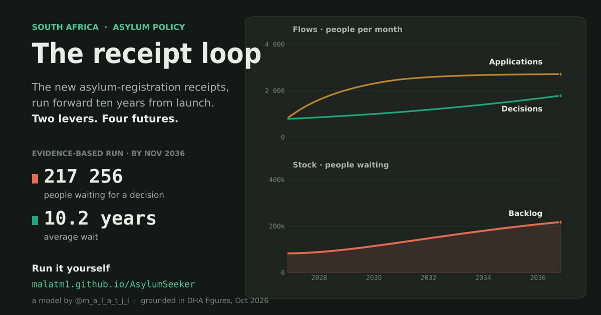

# The Receipt Loop

An interactive system-dynamics model of South Africa's asylum-registration receipt policy.

**Run it: [malatm1.github.io/AsylumSeeker](https://malatm1.github.io/AsylumSeeker/)**



## What this is

From 10 November 2026, South Africa begins issuing asylum-registration receipts that shield first-time applicants from deportation while their claims are decided — the government's answer to the Constitutional Court judgment of 7 July 2026, which barred deporting asylum seekers for lacking a transit visa.

Critics call the policy a pull factor. Supporters call it constitutional compliance. Both are describing feedback loops, so this model lets anyone run them: a month-by-month simulation from November 2026 to November 2036, starting from the Department of Home Affairs' own figures, with two levers the public debate is really about.

- **Word-of-mouth pull** — how strongly the deportation shield draws new arrivals once word spreads along migration routes.
- **Capacity build speed** — how fast Home Affairs expands its decision-making in response to backlog pressure.

Four preset scenarios (Status quo, Evidence-based, Worst case, Reform wins) bracket the plausible futures, and the levers can be dragged mid-run to steer. Every run exposes its month-by-month numbers in a table on the page.

## The two loops

- **The pull loop (reinforcing).** A receipt shields the holder from deportation → the risk of coming falls → word spreads → more people register → more receipts circulate. Each turn amplifies the next, at word-of-mouth speed.
- **The strain loop (balancing).** More claims swell the backlog → waits stretch into years → legal and political pressure builds → capacity expands → the backlog slowly drains. Each turn corrects the last, at government speed.

The policy question the model makes visible is which loop runs faster.

## Grounding (October 2026)

| Figure | Value | Source |
|---|---|---|
| New asylum applications | ≈ 800 / month (under 10 000/yr, 2020–2025; ≈ 20 000 in 2023) | [The Citizen](https://www.citizen.co.za/news/south-africa/home-affairs-confirms-90-000-refugee-appellants-unaccounted-for-in-south-africa/) |
| Decisions | ≈ 780 / month (≈ 9 300 in the past year: 1 934 approved, 7 392 rejected) | [IOL](https://iol.co.za/news/south-africa/2026-06-24-why-south-africas-asylum-system-is-facing-unprecedented-pressure/) |
| Starting backlog | 82 348 active asylum cases | [IOL](https://iol.co.za/news/south-africa/2026-06-24-why-south-africas-asylum-system-is-facing-unprecedented-pressure/) |
| Appeals (outside this model) | ≈ 161 000 cases at the Refugee Appeals Authority | [GroundUp](https://groundup.org.za/article/asylum-seeker-appeal-backlog-rises-to-161000/) |
| Historical arrivals elasticity | 223 000 new applicants in 2009 alone | [The Citizen](https://www.citizen.co.za/news/south-africa/home-affairs-confirms-90-000-refugee-appellants-unaccounted-for-in-south-africa/) |
| Reform pace | ≈ 19 000 appeal cases cleared in 2025/26 | [IOL](https://iol.co.za/news/south-africa/2026-07-09-home-affairs-cuts-refugee-appeals-backlog-by-nearly-19-000-cases-through-system-reforms/), [Polity](https://www.polity.org.za/article/da-welcomes-schreibers-home-affairs-clearing-more-than-19000-refugee-appeals-backlog-2026-07-10) |

## The model

Monthly steps, all arithmetic in `index.html` (no build, no dependencies beyond Google Fonts):

```
awareness   S += (0.005 + 0.06·pull) · (1 − S)
arrivals    a  = 800 · (1 + pull·S · (2.4 + 0.16·min(wait_years, 10)))
decisions   processed = min(backlog + a, capacity)
backlog     B += a − processed
capacity    C ×= 1 + build · 0.018 · min(wait_years, 10) / 10
```

Starting values: `a₀ = 800/month`, `C₀ = 778/month`, `B₀ = 82 348`. The arrivals response and reform pace are stylised from the historical record above; the starting figures are real.

## What this is not

A Department of Home Affairs forecast. It is a conceptual model built for public reasoning: the futures on the chart are scenarios the user chooses, not predictions. The 161 000-case appeals backlog sits outside the simulated stock.

## Repository

- `index.html` — the entire model, page and charts (single file)
- `receipt-loop-card.png` — 1200×630 social-preview card
- `.github/workflows/pages.yml` — deploys to GitHub Pages on every push to `main`

## Credit

A model by [@m_a_l_a_t_j_i](https://x.com/m_a_l_a_t_j_i).
